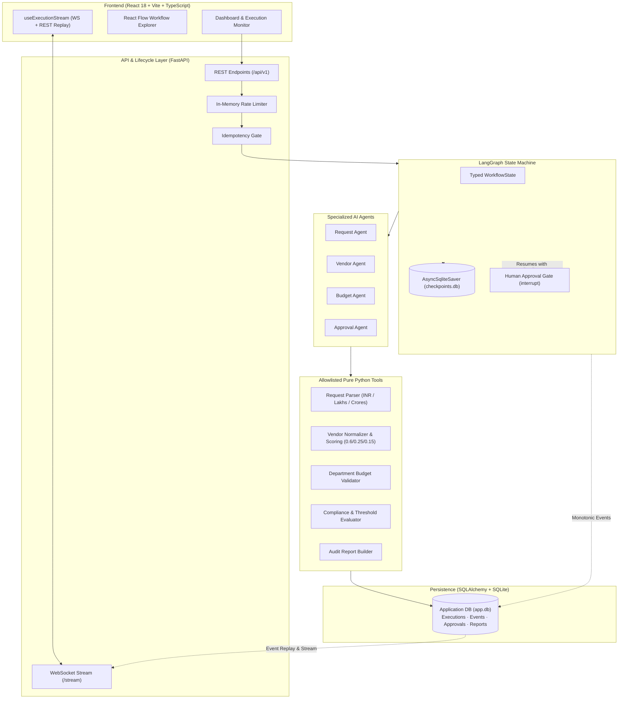
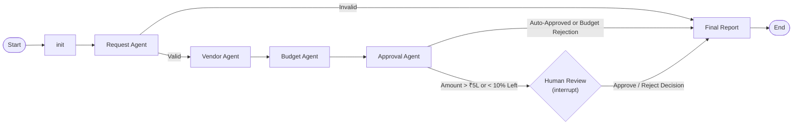

# Enterprise AI Workflow Orchestration Platform

[](https://fastapi.tiangolo.com)
[](https://langchain-ai.github.io/langgraph/)
[](https://react.dev/)
[](https://www.typescriptlang.org/)
[](https://www.docker.com/)
[]()
[](LICENSE)

An enterprise-grade, multi-agent workflow orchestration platform built for high-stakes business automation. Powered by **LangGraph**, **FastAPI**, and **React Flow**, this project demonstrates how to coordinate autonomous AI agents with **deterministic financial guardrails**, **fault-tolerant human-in-the-loop approval gates**, **restart-resilient state checkpointing**, and **real-time WebSocket event streaming**.

> **Note:** All catalog vendors, pricing, and departmental budgets are synthetic. No real financial transactions are executed.

---

## 🌟 Executive Summary & Engineering Highlights

Autonomous multi-agent systems often suffer from non-deterministic outputs, hallucinated calculations, and fragile state management. This platform solves these enterprise challenges through rigorous engineering:

- **100% Deterministic Financial Calculations**: The LLM is never permitted to calculate prices, delivery scores, tax, budget subtractions, or approval policy routing. All business math and scoring formulas run in pure, unit-tested Python.
- **Durable Human-in-the-Loop (`interrupt()`)**: If a purchase exceeds policy thresholds (e.g., > ₹5,00,000 or < 10% department budget remaining), the workflow safely pauses. Execution state is persisted to an SQLite checkpointer (`checkpoints.db`). **The system can experience a total server restart or process crash, and the approval will still be waiting to resume seamlessly.**
- **Dual Execution Engine (`demo` vs. `llm`)**:
  - **`demo` mode (Default)**: Completely offline with zero external dependencies or API keys. Uses deterministic regex parsing for Indian financial formats (`₹8,00,000`, `8 lakh`, `1.2 crore`).
  - **`llm` mode (Optional)**: Integrates local **Ollama** (`llama3.1:8b`) for structured JSON schema extraction and report prose, backed by retry logic and circuit-breaking.
- **Persist-Then-Publish Streaming**: Every agent action, tool invocation, and routing branch is committed to SQLite with a monotonic sequence number *before* publishing over WebSockets. If the client disconnects or refreshes, it replays missed events by sequence with zero data loss or duplication.
- **Dynamic Graph Discovery**: The React Flow workflow visualization in the UI is not hardcoded—it queries `GET /api/v1/workflows/procurement` and renders the exact compiled LangGraph topology from the backend.

---

## 🏗️ System Architecture



---

## 🤖 The Multi-Agent Pipeline

The procurement lifecycle is broken down into four isolated agents extending a strict `BaseAgent` contract with Pydantic validation:



### Agent Roster & Responsibility Matrix

| Agent | Responsibilities | Tools Used | Deterministic vs. LLM |
|---|---|---|---|
| **1. Request Agent** | Extracts quantity, product, department, and maximum budget from raw text. Validates against catalogs. | None (internal parser) | **Demo**: Regex & Indian currency normalizer.<br>**LLM**: Ollama JSON schema extraction. |
| **2. Vendor Agent** | Evaluates vendor candidates within budget. Normalizes price, delivery, and rating to score quotes. | `get_vendors` | **Scoring**: $0.60(1 - P_{\text{norm}}) + 0.25(1 - D_{\text{norm}}) + 0.15 R_{\text{norm}}$.<br>**LLM**: Generates 2-3 sentence justification prose. |
| **3. Budget Agent** | Verifies department budget allocation, remaining funds, and request maximums. | `get_department_budget`, `calculate_budget_check` | **Pure Python**: 100% deterministic arithmetic. (LLM disabled). |
| **4. Approval Agent** | Evaluates compliance policies. Auto-rejects budget overruns; flags requests above ₹5,00,000 for human review. | `evaluate_policy` | **Policy Engine**: Deterministic rule matcher.<br>**LLM**: Concise executive summary prose. |

---

## ⚡ Quick Start

### Option 1: Docker Compose (Recommended)

Run the entire platform (backend, frontend, database, and migrations) with a single command:

```bash
docker compose up --build
```

- **Frontend Application:** [http://localhost:5173](http://localhost:5173)
- **Interactive OpenAPI Docs:** [http://localhost:8000/docs](http://localhost:8000/docs)
- **Health Check Endpoint:** [http://localhost:8000/api/v1/health](http://localhost:8000/api/v1/health)

---

### Option 2: Local Development (Native)

#### Prerequisites
- **Python 3.10+** (Tested on Python 3.11)
- **Node.js 20+** & npm

#### 1. Backend Setup
```bash
cd backend

# Create and activate virtual environment
python -m venv .venv
source .venv/bin/activate       # Windows PowerShell: .venv\Scripts\Activate.ps1

# Install dependencies
pip install -r requirements-dev.txt

# Start backend (auto-migrates SQLite & seeds reference data on startup)
uvicorn app.main:app --reload --port 8000
```

#### 2. Frontend Setup (In a separate terminal)
```bash
cd frontend

# Install packages
npm install

# Start Vite dev server
npm run dev
```

---

## 🎯 Verification Scenarios (End-to-End)

The platform is seeded with 8 vendors and 4 departmental budgets (Engineering ₹12L, Finance ₹6L, Marketing ₹4L, HR ₹2.5L). The following automated test scenarios demonstrate every path through the state graph:

| # | Request Text | Outcome | What Happens |
|---|---|---|---|
| **1** | *"Purchase 10 laptops for engineering with max budget ₹8,00,000."* | ⏸️ **Waiting for Approval** | Recommends Zenvolt (₹6,85,000). Total exceeds ₹5,00,000 threshold. Graph pauses for manager decision. |
| **2** | *"Purchase 2 monitors for finance with max budget ₹50,000."* | ✅ **Auto-Approved** | Recommends Zenvolt (₹26,400). Total is within all policy thresholds. Completes with no human intervention. |
| **3** | *"Purchase 20 laptops for engineering with max budget ₹20,00,000."* | ❌ **Auto-Rejected** | Quote of ₹14,80,000 exceeds available engineering budget (₹12,00,000). Budget agent rejects. |
| **4** | *"Purchase 5 laptops for marketing with max budget ₹1,00,000."* | ❌ **Auto-Rejected** | No catalog vendor can supply 5 laptops for under ₹1,00,000. Vendor agent skips; workflow rejects. |
| **5** | *"Buy some stuff for office."* | ⚠️ **Validation Failure** | Request agent fails extraction. Routes directly to final report with `failed_validation`. |
| **6** | Scenario 1, but human reviewer selects **Reject**. | 🛑 **Rejected** | Manager provides a rejection reason. Graph resumes and writes the final audit report. |

---

## 🧪 Comprehensive Test Suite

The test suite covers unit logic, integration workflows, database persistence, and crash recovery:

```bash
# 1. Backend: 70 unit, integration, and API tests
cd backend
pytest -v

# 2. Frontend: Vitest component tests (Timeline, ApprovalPanel, ModeBadge)
cd frontend
npm test

# 3. End-to-End: Full Playwright journey test (requires running app)
cd frontend
npx playwright install chromium
npm run e2e

# 4. Evaluation Benchmark: Field extraction accuracy evaluation (30 prompts)
python evals/run_eval.py
```

### Crash Recovery & Restart Test
To verify the checkpointer's resilience:
```bash
pytest backend/tests/test_workflow.py -k "test_resume_after_restart"
```
*This test executes a workflow to an `interrupt()`, terminates the running application instance, constructs a fresh stack from the same SQLite checkpointer, and resumes execution seamlessly.*

---

## ⚙️ Environment Configuration

Configuration is loaded from environment variables or `backend/.env` (see `.env.example`):

| Variable | Default | Purpose |
|---|---|---|
| `EXECUTION_MODE` | `demo` | `demo` (rule-based parser) or `llm` (Ollama integration). |
| `DATABASE_URL` | `sqlite:///./data/app.db` | SQLAlchemy connection string for execution history. |
| `CHECKPOINT_DB_PATH` | `./data/checkpoints.db` | SQLite database for LangGraph state checkpoints. |
| `CORS_ORIGINS` | `http://localhost:5173` | Allowed origins for web client. |
| `OLLAMA_BASE_URL` | `http://localhost:11434` | Base URL for Ollama in `llm` mode. |
| `OLLAMA_MODEL` | `llama3.1:8b` | Model name for JSON extraction and prose generation. |
| `RATE_LIMIT_EXECUTIONS_PER_HOUR` | `10` | IP-based rate limit for executions. |
| `DEMO_RESET_ENABLED` | `true` | Allows one-click state clearing via `POST /api/v1/demo/reset`. |

---

## 📂 Project Structure

```
├── backend/
│   ├── alembic/                # Database migrations
│   ├── app/
│   │   ├── agents/             # Request, Vendor, Budget, and Approval agents
│   │   ├── api/                # FastAPI routes, rate limiter, serializers, error handlers
│   │   ├── config/             # Pydantic BaseSettings and policy constants
│   │   ├── database/           # SQLAlchemy models, repositories, idempotent seeder
│   │   ├── events/             # In-memory pub/sub and persist-first EventPublisher
│   │   ├── orchestration/      # LangGraph state machine, routing functions, checkpointer
│   │   ├── schemas/            # Domain models and API request/response contracts
│   │   ├── services/           # ExecutionService lifecycle manager and Ollama client
│   │   └── tools/              # Allowlisted pure Python tools (parser, scoring, policy)
│   ├── tests/                  # 70 pytest tests (unit, workflow, API, crash recovery)
│   ├── Dockerfile
│   └── requirements.txt
├── frontend/
│   ├── src/
│   │   ├── components/         # AgentPipeline, ApprovalPanel, EventTimeline, React Flow nodes
│   │   ├── hooks/              # Custom hooks: useExecution, useExecutionStream (WebSocket)
│   │   ├── pages/              # Overview, WorkflowExplorer, ExecutionMonitor, Architecture
│   │   └── services/           # Typed REST and WebSocket clients
│   ├── e2e/                    # Playwright end-to-end integration tests
│   ├── Dockerfile
│   └── nginx.conf
├── evals/                      # 30-scenario procurement parsing benchmark
├── docs/                       # In-depth architectural designs and operational manuals
├── docker-compose.yml          # Multi-container orchestration specification
└── plan.md                     # Complete project specification and technical design
```

---

## 📚 Deep-Dive Technical Documentation

For in-depth architectural decisions, refer to the technical documents in [docs/](file:///d:/projects/Multi-Agent-Enterprise-Workflow-Automation/docs/):

- 🏛️ [Architecture Specification](docs/architecture.md) — Detailed request lifecycle, event ordering, and restart semantics.
- 🤖 [Agent Design Document](docs/agent-design.md) — Executor contracts, tool sandboxing, and prompt definitions.
- 🔄 [Workflow Design](docs/workflow-design.md) — State transitions, conditional branch matrices, and outcomes.
- 🗄️ [Database Schema](docs/database-schema.md) — Relational entity diagrams and table descriptions.
- ⚖️ [Architectural Decisions Log](docs/decisions.md) — Record of design choices and trade-offs.
- 📊 [Extraction Evaluation Report](docs/evals.md) — Precision, recall, and latency metrics across test prompts.
- 🚀 [Deployment & Demo Guide](docs/demo-guide.md) — Production deployment instructions for Render and Vercel.

---

## ⚖️ Engineering Trade-Offs & Honest Limitations

1. **Single-Process Event Bus**: The current WebSocket streaming architecture uses an in-memory event broadcaster backed by SQLite. In a multi-replica production environment, this should be backed by Redis Pub/Sub or Kafka.
2. **Ephemeral Storage on Free Tier**: Deployed instances on free hosting platforms (e.g., Render) use ephemeral local disks. To compensate, the backend runs idempotent schema migrations and reference data re-seeding on every boot.
3. **Authentication Scope**: As a portfolio demonstration, user authentication and RBAC are excluded; all human approval decisions are attributed to `demo_user`.
4. **Scope-Bounded Agent Tools**: Agents do not have arbitrary bash or shell execution capabilities; they can only invoke registered, type-safe Python tools with Pydantic validation.
